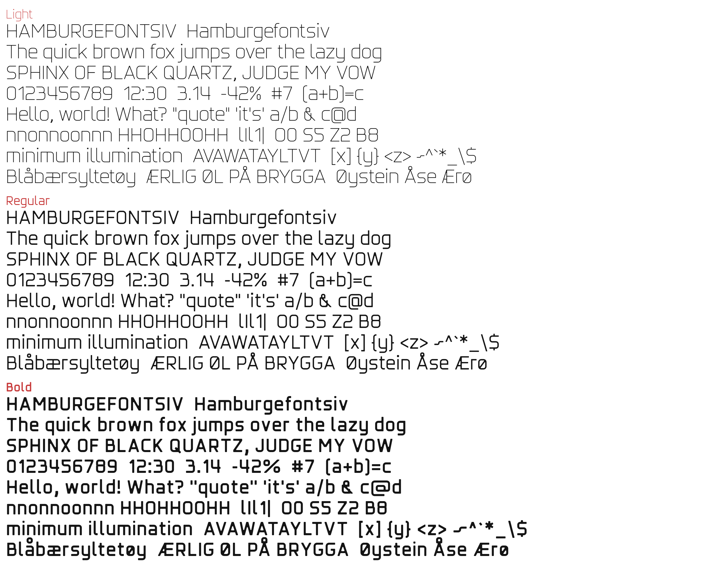

# Brokkr 3D fonts

Monoline fonts made for **3D printing**: text printed in a second colour in the **first layer** of a print.
Every stroke is a whole number of 0.4 mm nozzle lines at the base size (8 mm cap height), stroke ends and
junctions are rounded, and gaps never get narrower than a line, so the text prints clean in both colours.

| Family | Folder | Fonts | Status |
|---|---|---|---|
| **Brokkr Sans 3D** | `families/sans/` | `fonts/BrokkrSans3D/` – Light, Regular, Bold | v0.9, test print pending |
| **Brokkr Serif 3D** | `families/serif/` | – | planned |



## Brokkr Sans 3D at a glance
- 101 characters: A–Z, a–z, Æ Ø Å æ ø å, 0–9 and all printable ASCII punctuation.
- Strokes at **8 mm caps**: Light 0.4 mm (1 line) · Regular 0.8 mm (2 lines) · Bold 1.2 mm (3 lines).
  Caps are 0.7 em, so if your tool's size is the em size, size 11.43 mm gives 8 mm caps (tools differ — check).
- Kerned (about 1,000–1,400 pairs per weight), with a printing floor: letters never come closer than the stroke
  width plus 30 units, so the background colour still prints between them. Digits are not kerned.
- Design notes, measurements and slicer results: [`families/sans/NOTES.md`](families/sans/NOTES.md).

## Slicer settings for the text
Layer and first layer 0.2 mm, Arachne walls, **0.4 mm line width** for the first layer (and for the perimeters /
walls too when the text is more than one layer deep), and for the text:
**minimum wall/perimeter width 50 %**, **wall transitioning threshold angle 40°**, **wall transition length 40 %**
(Bambu Studio / Orca: also *initial layer minimum wall width* 50 %). With slicer defaults, crossings in `# + t f 4`
keep a small hole and dots under about 0.7 mm disappear. Full details in the notes and in
[`testprint/sans/README.md`](testprint/sans/README.md).

Text on the bed side is seen from below, so it has to be **mirrored left–right in the model** to read the right
way round (the test plate already is).

## Repository layout
```
tools/             shared by every family
  fontlib.py         family loader: every tool takes the family as its first argument
  b3d_geom.py        geometry engine: union of sharp shapes, then true-arc fillets
  render.py          pure-Python PNG specimens
  kerning.py         autokerning with a printing floor
  slice_test.py      slices glyphs in PrusaSlicer and scores the first-layer toolpaths
  measure_stroke.py  thickest spot per glyph
  build_ttf.py       builds the TTFs (fontTools)
  check_ttf.py       reads the TTFs back and checks them
  make_testprint.py  two-colour test plate (3MF + STLs), optional slicer check
families/<family>/   one folder per family: glyphs.py (names, metrics, spacing), the drawings, kerning.json, NOTES.md
fonts/<Family>/      built font files
specimens/<family>/  specimen images
testprint/<family>/  print-ready test plate
out/                 analysis output (not committed; its G-code is analysis-only — never print it)
```

## Building
Python 3.10+ (standard library), plus [fontTools](https://github.com/fonttools/fonttools) for the TTF steps and
PrusaSlicer 2.9 for the slicer checks (path at the top of `tools/slice_test.py`).
```
python -I families/sans/glyphs.py                 # SVG sheets; lists any corner radius that had to be reduced
python -I tools/render.py sans                    # specimens/sans/*.png   (add "kern" for the kerning sheet)
python -I tools/kerning.py sans                   # families/sans/kerning.json
python -I tools/build_ttf.py sans                 # fonts/BrokkrSans3D/*.ttf
python -I tools/check_ttf.py sans                 # direction, crossings, kerning + specimen from the TTFs
python -I tools/make_testprint.py sans --verify   # testprint/sans/ + two-extruder slicer check
python -I tools/slice_test.py sans out/sans/slicer                    # slice every glyph, all weights
```

## Adding Brokkr Serif 3D
1. Copy `families/sans/` to `families/serif/`.
2. In `families/serif/glyphs.py` set `SLUG = "serif"`, `FAMILY = "Brokkr Serif 3D"`, `PS_FAMILY = "BrokkrSerif3D"`,
   and adjust metrics, weights and spacing. Keep `COPYRIGHT` / `LICENSE` (the reserved name "Brokkr" covers it).
3. Redraw the glyph functions (keep the stroke, gap and corner rules), delete the copied `kerning.json`.
4. Run the tools above with `serif` instead of `sans`. Everything lands in its own folders.

## Licence
Copyright 2026 **Brokkr 3D AS** (https://brokkr.design).

- **Fonts and font sources** (`fonts/`, `families/`): [SIL Open Font License 1.1](OFL.txt) with the
  **Reserved Font Name "Brokkr"**. You may use, study, modify and share them, and bundle them with software —
  but not sell the fonts on their own, and modified versions must stay under the OFL and may not use the name
  "Brokkr" (rename them). Covers Brokkr Sans 3D and future Brokkr families.
- **Tools** (`tools/`): [Mozilla Public License 2.0](tools/LICENSE). Changes to these files must be shared under
  the MPL; they can be used inside other projects.
- **What you make with the fonts** — prints, STL/3MF files, labels, products — is yours and not restricted by
  either licence.

Contributions are welcome under the same licences. Outside contributions to the fonts may be asked to sign a
contributor agreement, so Brokkr 3D AS keeps the option of offering other licence terms later.
